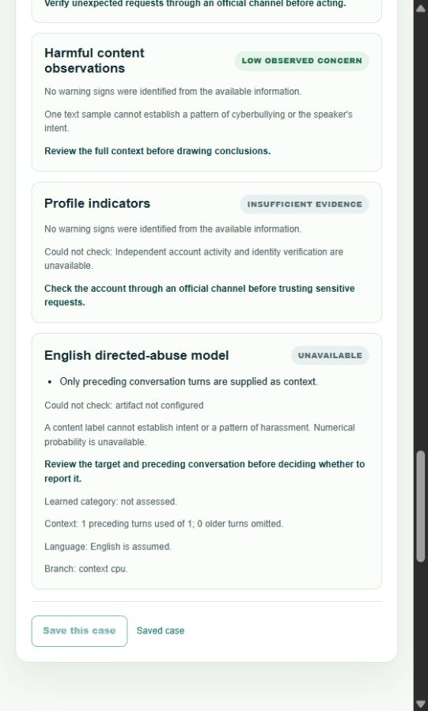

# Conversation application browser verification

Date: 2026-10-14. Tested the implemented branch in the Codex in-app browser at
`http://127.0.0.1:8789`, with an isolated disposable SQLite database. All content
was invented for software verification; no research-source or user cases were used.

Verified in the actual browser:

- Enabled ordered turns, added three turns, and selected the middle target.
  The readonly message mirrored that target. Coverage showed one preceding turn
  used and one later turn excluded. A later insult did not alter the earlier
  target's phrase observations. The learned card was unavailable without a model
  and showed the English assumption and no probability.
- Saved the exact signed snapshot, cleared the form and reopened its exact turns,
  selected target and displayed result. Saved cases were not silently reanalysed.
- Exported JSON through the actual browser download. The downloaded 3,048-byte
  file was inspected: three exact turns, middle target, context branch, original
  observations and no receipt embedded in the stored result.
- Submitted markup-looking text remained text in the saved-case title; DOM
  inspection found zero injected images. No executable markup was created.
- Switched to reply mode, selected explicit backward parents, and used the keyboard
  to select a target. Attempting to move a child before its parent was rejected
  with a repair instruction; valid draft data was preserved.
- Recorded local incorrect feedback. Deleted only the disposable saved case;
  the browser then showed no saved cases. One input-dispatch call timed out after
  deletion; fresh browser state confirmed that deletion had completed, so it was
  not repeated.
- Tested a 390 CSS-pixel viewport: document width was 390 with no horizontal
  overflow. Reset the temporary viewport. The readable screenshot below was
  captured at the normal browser viewport; an earlier raw screenshot capture was
  blank and was replaced by the supported screenshot method.
- Stopped only the owned test server. Analysis displayed “Cannot reach the local
  Sentinel service. Start Sentinel and try again.” Recovery was checked after
  restarting that isolated service.

Late analysis/save/clear/open/selection races, unsigned older-server responses and
expired receipts are verified by the real JavaScript in controlled DOM tests.
They were not forced with artificial network interception in this browser.
Actual Chrome toolbar/context-menu checks remain deferred; no extension
installation or permission expansion was performed.
