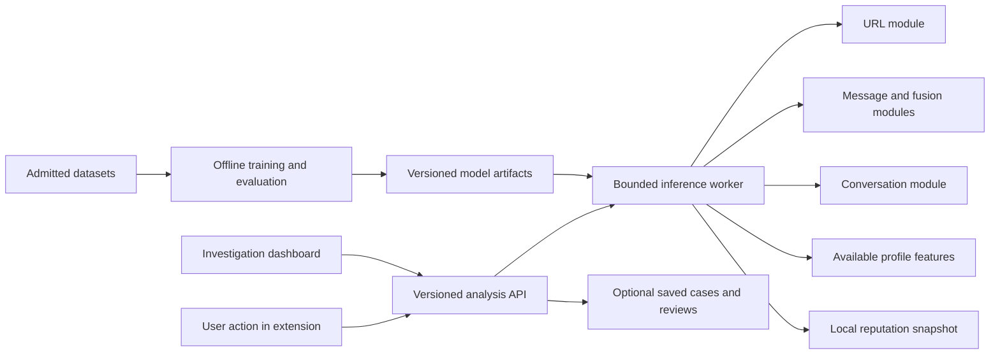

# Sentinel: year-long engineering major-project design

Date: 2026-10-05. Status: **approved by the user on 2026-10-05**. The user selected a balanced emphasis on ML research and a usable application, then approved this written specification. The existing software is Phase 0; the components below are proposed work, not implemented capabilities or measured results.

## Purpose and success

Build an explainable social media safety assistant that helps a person investigate a suspicious message, linked destination, harmful conversation, or account using information they can lawfully supply. A student encountering a scholarship or job-payment request should be able to check it from the browser, understand the available evidence, save a case, and verify through the organisation's official channel. A community reviewer should be able to review a conversation with its context and record a reasoned decision.

The project succeeds through reproducible experiments, evaluated trained modules, and a complete investigation workflow. Model complexity and feature count alone do not establish a research contribution. A carefully evaluated negative result is valid; an unmeasured accuracy claim is not.

Assumptions: a four-member team, twelve months from the agreed project start, English as the first supported language, and no required paid API or cloud service. The laptop has a Ryzen 7 7435HS, 16 GiB RAM and an RTX 3050 Laptop GPU with 4 GiB VRAM, verified locally. Team size and schedule can be revised without changing the initial ML foundation.

## What exists and what will change

Phase 0 provides the local Python API, SQLite cases, a static web client, explicit-click extension, cautious rules, paired Naive Bayes experiments, and independent-review collection tooling. It has an exploratory spam/ham benchmark; this is not a phishing evaluation. Current automated and browser-check records describe software behaviour, not detector quality.

Keep Phase 0 runnable as a reference. Introduce trained modules through versioned adapters rather than changing the meaning of existing results silently. The [original implementation plan](../../implementation-plan.md), [baseline evaluation protocol](../../evaluation-protocol.md), and existing presentation describe that earlier prototype.

Three approaches were considered:

| Approach | Benefit | Limitation |
| --- | --- | --- |
| Expand rules and the current interface | Quick demonstration; little compute | Insufficient trained-model research depth for the requested scope |
| **Evaluated ML modules plus an investigation application** | Balances experiments, systems engineering and practical use | Requires sustained annotation, integration and validation; selected direction |
| Large general-purpose model and continuous platform monitoring | Broad ambition | Data access, compute and evaluation would dominate; unnecessary for the core question |

## Research programme

The primary question is: **Does combining message and URL models improve phishing-request detection on unseen destination domains and, where identifiable, unseen campaigns, at an acceptable false-positive rate?**

Evaluate message-only, URL-only and combined models on the same genuine pairs and split. Strip all URLs from the message-only branch. The main binary label is `phishing_request` versus `verified_legitimate_request`; retain spam, uncertain and other suspicious content separately rather than relabelling them as phishing. A fraud-related observation can still be shown in the application without claiming it matches this research label.

Compare Phase 0 rules/Naive Bayes, TF-IDF with a linear classifier, URL lexical features with a tree-based classifier, and a compact message encoder if its pilot fits the hardware. Compare early feature concatenation with learned late fusion. Train fusion using out-of-fold branch predictions generated only within the training partition; fitting it to in-sample scores would give an unfair result. Include missing-modality tests and ablations for context and reputation.

The primary comparison is held-out recall at thresholds selected on validation data under a **5% validation false-positive-rate budget**. Report the actual test false-positive rate, precision, F1, PR-AUC, coverage/abstention and group-bootstrap intervals alongside it. The 5% budget is an experiment setting, not a claim that deployment meets it or a universal acceptable risk. Paired comparisons must use the same cases. Overlapping seeded splits are sensitivity checks, not independent replications.

Harm and profile studies are separate secondary experiments, with their own labels and evaluation. Do not average toxicity into a phishing score. Do not turn a bot dataset label into an impersonation or fraudulent-identity label.

## Modules and deliverables

| Subproject | Required output | Evidence needed before release |
| --- | --- | --- |
| A. ML foundation and URL detector | Source adapter, audited URL-only features, reproducible grouped benchmark, calibrated artifact and inference adapter | Frozen data/split hashes, baseline comparison, label mapping, memory/latency measurements, model card |
| B. Paired message–URL detection | Verified paired dataset, message classifier, learned fusion, independent reputation evidence | Two-reviewer/adjudication record, comparable sources, fair branch comparison, held-out error analysis |
| C. Contextual harmful content | Trained English module accepting ordered conversation turns; quoted/reported speech handling | Conversation-grouped splits, task-aligned labels, message-only/context comparison and adjudicated challenge cases |
| D. Account assessment | Feature-capability schema and evaluated bot-likelihood classifier for supported supplied data | Account-disjoint test, obtainable-feature audit, missing-data behaviour and source-shift analysis |
| E. Investigation application | Typed API, dashboard, case timeline, human review, explicit sharing, export/deletion and extension integration | Workflow, access-control and compatibility checks, pilot task completion and interpretation results |
| F. Delivery and evaluation | Reproducible release, final report, deployment guide, demonstration and revised presentation | Frozen final results, limitations, data/model cards, user-pilot record and fresh-clone verification |

Each subproject gets a focused design and implementation plan. A starts first; its [written specification](2026-10-05-sentinel-ml-foundation-design.md) is included for review. B's data collection can proceed alongside A. Do not scaffold every subsystem before the first trained artifact is reproducible.

### Harmful content

Accept speaker IDs that are local to a case, ordered turns, and optional relative timestamps supplied by the user. Preserve who said what; do not infer real identities. Distinguish harmful-language classification from conversation-level indicators such as repeated targeting. Missing context produces an explicit limitation. Quoted abuse, reporting abuse and ordinary disagreement belong in the challenge set.

Use task-aligned public English data for the first trained classifier after a label/licence audit. HASOC provides leads for English/Hindi, code-mixed and conversational tasks across different years; availability is not a guarantee that any one release supports all these labels. English–Hindi evaluation is a separate milestone, conditional on suitable data and hardware. If unavailable, record English-only support rather than claim multilingual performance. [HASOC dataset catalogue](https://hasocfire.github.io/hasoc/2024/dataset.html)

### Profile and activity assessment

Define a capability matrix: public counts, account age when actually known, supplied activity summary, and any permitted relationship edges. Train only on the subset available at inference. A pasted profile link supplies no private history. The author-released TwiBot-22 dataset is a candidate for bot research; audit labels, access, licences, storage and feature availability before selecting a subset. Full graph training is optional and is not assumed to fit this laptop. [TwiBot-22 author repository](https://github.com/LuoUndergradXJTU/TwiBot-22)

Provide bot likelihood only when the selected feature set passes validation. Otherwise report insufficient evidence. Display suspicious behaviour observations separately. Impersonation requires supplied identity/organisation evidence and remains a human verification task; low followers or a new account is never sufficient proof.

## Data feasibility and controls

As of this design: the local intake has **zero admitted rows**; the sheets contain 100 unreviewed NC State phishing candidates and 18 unreviewed potential legitimate SMS candidates. These are review batches, not the source sizes. The NC State importer found 8,085 eligible deduplicated pairs before sampling. The [source audit](../../real-dataset-source-audit.md) records original counts, pairing limits and hashes.

NC State supplies actual SMS/message-link pairs but no matched legitimate group. UCI spam/ham labels and unlabelled NUS messages cannot establish legitimacy. Differences in source, channel and date could become label shortcuts. Do not fabricate pairs, reconstruct redacted destinations, silently admit candidates, or train from application feedback automatically. [NC State author release](https://github.com/wspr-ncsu/sms-phishing)

Aim for **2,000 reviewed pairs, including at least 1,000 per class**, with an independently held-out test containing at least 100 cases per class and 30 distinct domain groups. These are planning targets, not sufficient proof of representativeness. At the end of Month 2, review legitimate-pair availability, independent verification, source/class imbalance and connected-group sizes. If those targets are infeasible, continue the standalone modules, report the paired study as incomplete, and revise the research question with the project supervisor. A URL-only dataset cannot answer the combined-evidence question.

All datasets need provenance, reuse conditions, original label semantics, redaction/admission rationale, source hashes and exclusions. Retain source timestamps separately from collection dates; missing dates stay missing. Private contributions require consent and a traceable legitimate basis. Keep raw messages and URL tokens in controlled, Git-ignored local storage; Git ignore is not encryption or protection from cloud sync. Publish aggregate results and permissioned examples only.

For URL work, PhiUSIIL is a practical first candidate: UCI documents 235,795 records and CC BY 4.0 terms. It mixes URL and webpage features, so the deployed URL model will derive its own features from URL strings. Its original label `1` means legitimate and `0` means phishing; the importer must explicitly reverse these to Sentinel's convention. This is a separate URL benchmark. [UCI PhiUSIIL](https://archive.ics.uci.edu/dataset/967/phiusiil%2Bphishing%2Burl%2Bdataset)

## Proposed architecture

Use a modular Python application with separate offline training and bounded inference processes. This allows independent module work without the operational cost of many services.

| Layer | Proposed choice and reason |
| --- | --- |
| API/contracts | FastAPI and Pydantic for explicit input/output validation and OpenAPI; avoid hand-maintaining several client contracts |
| Application UI | React and TypeScript for case/review state, evidence panels and job status; retain Phase 0 until replacement workflows pass |
| Training | scikit-learn for CPU baselines; PyTorch/Transformers only for justified compact neural experiments |
| Persistence | SQLAlchemy/Alembic; SQLite for personal use, PostgreSQL for a controlled team deployment |
| Execution | One bounded inference worker initially; training invoked separately; no required Redis, Kafka or Kubernetes |
| Reproducibility | Locked environments, dataset/split manifests, config/seed/commit records and versioned model cards |

FastAPI's validation/OpenAPI support motivates this choice; authentication and authorisation still need explicit implementation. [FastAPI features](https://fastapi.tiangolo.com/features/)

Use a dedicated Python 3.11 ML environment and pin compatible versions after an installation smoke check. Preserve the dependency-free prototype launcher. GPU experiments use the supported Windows PyTorch wheel after verifying device availability; a driver alone does not establish a working training environment. [PyTorch local setup](https://pytorch.org/get-started/locally/)

### Analysis contract and lifecycle

The new contract accepts a message, submitted URL(s), ordered conversation turns and supplied profile facts. Record which capabilities were actually supplied and which URL came from which message. For multiple URLs, assess them individually; do not silently choose one or feed an unsupported input into a single-pair fusion model.

Results preserve separate phishing/fraud observations, harmful content and profile outputs. Each contains a processing state (`complete`, `degraded`, `not_assessed`, `insufficient_evidence` or `unavailable`), task-specific decision, observed evidence, optional model attribution, uncertainty, model version, missing checks and recommended action. Attributions explain a model's input dependence, not causation or proof. Numeric probabilities appear only with documented calibration; they remain conditional on the evaluation distribution.

Propose `/api/v1/analysis-jobs`: validated submission returns a job ID; clients poll status/result and may cancel. Start with one running job and at most eight queued jobs, reject overflow clearly, enforce a 60-second execution timeout, and expire unsaved result data after 15 minutes. Proposed request caps are 10,000 message characters, 20,000 conversation characters, 2,048 characters per URL, and five URLs. Model token limits and truncation must also be reported. Cancel/delete/timeout must discard temporary content and release worker capacity; request logs must not retain it. Exact queue and performance settings will be measured in integration.

Keep a local `/api/analyze` compatibility adapter during migration. Saving captures the reviewed input and exact assessment/model version; it must not silently re-run with a newer model. A requested reanalysis becomes a new case assessment version. Missing artifacts/feed or failed optional modules leave explicit partial results, never a safe verdict. Reputation is a distinct check: exact matched records can supply evidence, while an absent record means unlisted. The server does not visit submitted websites, expand redirects or query private network targets.

### Investigation and deployment

Core workflows: check selected text/link; inspect evidence; optionally save; add notes or a reviewer decision; see assessment history; export a readable report and structured JSON; delete the case. Timeline entries retain provenance and model versions. Similar-domain/template case links are associations for review, not proof of coordinated fraud, and are limited to cases the user may access.

Personal mode stays on loopback with local ownership. Controlled team mode adds authenticated owner/reviewer/admin roles, case ownership and explicit sharing before any network exposure. Use established password/session libraries, enforce authorisation on reports and jobs as well as cases, and test cross-user denial. An administrator may manage users/models but does not automatically gain case-content access. A separate restricted research workspace holds annotation batches; personal cases enter it only through explicit consent/admission.

The extension keeps explicit user initiation and the local endpoint by default. Team-endpoint support requires a revocable, scoped pairing token and an explicitly configured host permission; never embed a shared secret. Restrict browser origins, treat submitted content as text, and verify exports do not execute it. Deletion removes active case content, reviews, derived links and temporary job results. Any deployment backup retention must be documented separately. No silent transfer of existing personal SQLite cases into team accounts.

## Evaluation and acceptance

Freeze training, validation, calibration and test manifests before modelling; target 70/10/10/10 proportions when group sizes allow. Keep connected components of shared registrable domains, identified campaigns and near-duplicate wording together. Use a versioned Public Suffix List, including private suffix boundaries, rather than last-two-label heuristics. For harm, group conversations/users when available; for profiles, group accounts and known related clusters. Disclose unknown connections and cases where a giant component makes a split infeasible.

Fit vocabulary/scalers/resampling and feature selection only on training. Select models and decision thresholds on validation; fit probability calibration on the separate calibration partition, then evaluate the frozen system once on test. A test-driven revision needs a new independent final test. Any externally pretrained URL model used in the paired study must exclude overlapping paired domains/campaigns and follow the same declared external-data policy for all comparisons.

Report confusion counts, precision/recall/F1 (positive-class and macro), PR-AUC, false-positive rate, coverage, Brier score and reliability/ECE where applicable. Use 95% group-bootstrap intervals and disclose intervals that are unreliable because of sparse classes/groups. Inspect class/source/language subsets, unfamiliar domains, source-held-out tests and temporal tests when authentic timestamps exist. Training-set balance is not real-world prevalence: show how low phishing prevalence affects positive predictive value and avoid interpreting benchmark probabilities as universal risk.

Reputation experiments record snapshot time. A current feed applied to historical cases is retrospective coverage unless time-correct snapshots exist; do not count future reports as early detection. Compare models independently from lookup augmentation.

Engineering acceptance includes fresh-clone reproducibility; no train/test leakage; schema and model-version compatibility; unsaved-data expiry; access-control/deletion checks; web and actual Chrome toolbar/context-menu workflows; and degraded behaviour with missing models, data and services. Use synthetic fixtures for software tests, never as final accuracy evidence.

Laptop targets to measure: at most 8 GiB training-process RAM for the standard CPU run; at most 3.2 GiB peak allocated/reserved GPU memory for a compact experiment; and warmed end-to-end analysis p95 of 5 seconds for one active job on bounded inputs. These are engineering targets, not present measurements. Record cold starts, token limits, memory and concurrency; if a target is missed, reduce the model/input budget or document the trade-off before release. Small batches and gradient accumulation are candidates for memory management, not guarantees of fit. [Transformers gradient accumulation](https://huggingface.co/docs/transformers/grad_accumulation)

Run a voluntary 15–20-person usability pilot with permissioned or synthetic scenarios and balanced presentation order. Measure task completion, warning interpretation, verification choices and time with/without explanations. Keep pilot examples separate from test data. Describe its small-sample limits and do not claim that it proves real-world fraud prevention.

## Twelve-month delivery sequence

| Period | Deliverable and exit condition |
| --- | --- |
| Months 1–2 | Subproject A data/source audit, split protocol and trained URL baselines; paired-label feasibility review; harm/profile feature and licence audit |
| Month 3 | Reproducible calibrated URL artifact, model card and inference adapter; first admitted paired batch with independent review; no research claim from candidates |
| Months 4–5 | Message and contextual-harm experiments, eligible profile baseline, expanding paired dataset; compact-model resource measurements |
| Month 6 | Fusion and ablations with validation-only selection; freeze final comparison protocol and data; conditional language/graph work proceeds only if core gates pass |
| Months 7–8 | API/UI migration, saved assessment versions, review/report/deletion, authenticated team demo and extension integration |
| Month 9 | Integrated reliability and access checks, deployment documentation, pilot preparation; core workflows pass before additional features |
| Months 10–11 | Frozen held-out evaluations, source/temporal robustness where possible, usability pilot and measured optimisation |
| Month 12 | Fresh-clone release, limitations and final report, architecture/demo presentation and viva preparation |

Suggested ownership: member 1 URL/message/fusion; member 2 harmful content; member 3 profile/data/versioning; member 4 application/integration/deployment. All members take independent annotation shifts, review another module, and understand the main experiment. Deliver a runnable milestone monthly, rather than leaving integration until the final semester.

Out of initial scope: continuous scraping of all platforms, automatic blocking, identity verification from a profile URL, deepfake detection, mobile apps, large-model pretraining and compulsory paid hosting. Conditional extensions do not substitute for unfinished core evaluation.

## Written-review boundary

The user approved this overall scope and the [first subproject specification](2026-10-05-sentinel-ml-foundation-design.md). The [focused implementation plan for A](../plans/2026-10-05-sentinel-ml-foundation.md) is now prepared for review and execution-method selection. Product code and dependencies remain unchanged at this planning stage. Later subprojects need their own focused specifications as their data and integration constraints become known.
