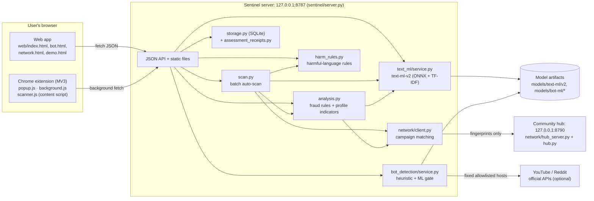
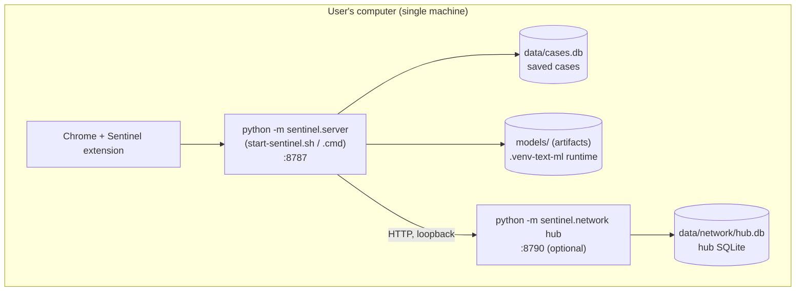
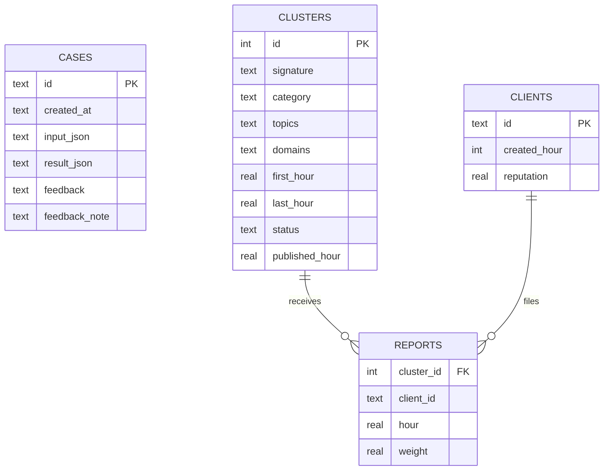
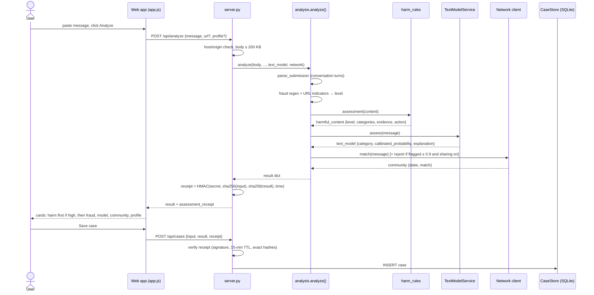
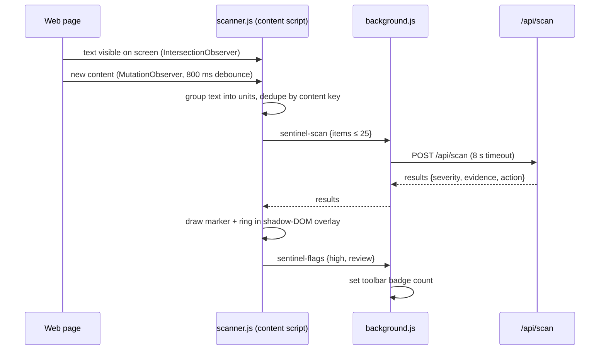

# Sentinel: viva preparation guide

This guide was built only from this project's own files: its source code, docs, model cards and recorded results, plus one live trace of the running app on 2026-11-06. Each claim points to the file it comes from, so you can open it during preparation.

> **Before the viva: update the README.** Its "Current status" table is dated 2026-10-14 and doesn't mention the auto-scan extension, the learned scam-text model, the community network, bot account detection or the harm-rule engine. For those modules, the dated docs and model cards listed here are the current source of truth.

---

## 0. Implemented vs planned (read this first)

| Area | Live in the app | Status | Source |
|---|---|---|---|
| Message and link evidence rules (fraud) | **Yes** | Rule-based and explainable | `sentinel/analysis.py` |
| Harmful-language detection (English and Hinglish) | **Yes** | Rule-based, 26 rules in 11 categories | `sentinel/harm_rules.py` |
| Learned scam-text model `text-ml-v2` | **Yes** (experimental) | DistilBERT + TF-IDF average, calibrated | `output/research/text-ml-v2/model-card.md` |
| Auto-scan browser extension | **Yes** | Opt-in per site, rules + text model | `docs/autoscan-extension.md` |
| Community scam network | **Yes** (prototype, loopback) | MinHash fingerprints and a k-anonymous hub | `docs/community-network.md`, `output/research/network-v1/results.md` |
| Bot account detection (heuristic) | **Yes** | 25 weighted signals | `docs/bot-detection.md` |
| Bot ML: profile model `bot-ml-v1` | Computed but **withheld** | **Failed** its release gate (worst unseen-dataset AUC 0.600) | `output/research/bot-ml-v1/model-card.md` |
| Bot ML: activity model `bot-ml-activity-v1` | **Yes** (X accounts, at least 20 posts) | **Passed** its gate (worst fold AUC 0.849) | same model card, activity section |
| Saved cases with signed receipts | **Yes** | SQLite, local only | `sentinel/storage.py`, `sentinel/assessment_receipts.py` |
| URL models url-ml-v1/v2/v3 | **No** (research only) | Measured; false positives block release | `README.md`, `docs/url-v3-delivery-record.md` |
| Paired message-link model | **No** | Software ready; real labelled intake is empty | `docs/paired-study-workflow.md` |
| Context-aware abuse model (CAD) | **No** | Real study "unavailable": failed its support gates | `docs/context-harm-delivery-record.md` |
| Profile identity verification, mobile app, team mode | **No** (planned) | | `docs/superpowers/specs/2026-10-05-sentinel-year-long-design.md` |

**How to say it in the viva:** "Everything in the first eight rows runs in the app today. The research models that failed their own release gates are deliberately kept out of the live app, and the release gate is part of the design, not an afterthought."

---

## 1. Project understanding

### 1.1 What it is
Sentinel (README title) is *"An Explainable Social Media Safety Assistant for Suspicious Profiles, Phishing Links, and Harmful Content."* A user gives it a message, a link, a conversation, profile facts or a social-media account. Sentinel returns **separate** assessments for fraud, harmful content and accounts, each with the **evidence** it found, the **checks it could not do**, and **a sensible next step**. Everything runs on the user's own machine (`server.py` refuses any host other than `127.0.0.1` or `localhost`).

### 1.2 Problem statement
People receive scam messages (fake jobs, KYC, parcel fees, "digital arrest"), abusive or threatening messages, and contact from automated or fake accounts. Existing protections are mostly **black boxes**: they say "unsafe" or nothing at all. They don't explain why, don't say what they couldn't check, and often require sending private messages to a cloud service.

### 1.3 Objectives
1. Detect fraud and phishing signals in messages and links, with explanations.
2. Detect harmful and dangerous language (threats, self-harm, harassment), including Hinglish.
3. Estimate whether a social-media account behaves like a bot, without scraping.
4. Warn users while they browse, on sites they opt in to.
5. Let users protect each other (community network) without sharing message text.
6. Measure every learned model honestly, with held-out tests, calibration and release gates, and keep models that fail out of the live app.

### 1.4 Proposed solution, in one paragraph
A local Python server (`sentinel/server.py`) exposes one JSON API. It's used by a web app (`web/`) and a Chrome extension (`extension/`). Each request runs through **independent analysers**: fraud evidence rules, harm rules, a learned scam-text model, a community-campaign matcher and a bot-account scorer. Each produces its own result block. Learned models are loaded only from **checksum-verified artifacts**, and a model is shown live only after passing its pre-registered gate.

### 1.5 What makes it different
| Typical tool | Sentinel |
|---|---|
| Single "safe/unsafe" verdict | Separate fraud, harm and account results, each with evidence and an "unavailable checks" list |
| Cloud processing of your messages | Local only, loopback server; the community network shares only anonymous fingerprints |
| Model accuracy reported on its own test set | Unseen-dataset tests, calibration, confidence intervals and release gates; failed models are kept out |
| English only | Harm rules and text model cover Hinglish too (text model: synthetic Hinglish data) |
| Can't see new scam campaigns | The community network warns about campaigns other users have flagged |

### 1.6 Analogy
Sentinel is like a **careful hospital triage desk**. Several specialists look at the same patient: the fraud desk, the harm desk, the lab test (the learned model), the public-health board (the community network) and the identity check (bot detection). Each writes its own note with the symptoms it saw and the tests it couldn't run. The triage nurse (the web app or extension) shows all the notes together. A new lab test only goes into use after a validation trial, and if it fails the trial it stays in the research lab.

### 1.7 Technical explanation
A stdlib `ThreadingHTTPServer` serves static pages and a JSON API on `127.0.0.1:8787`. `POST /api/analyze` validates input (a 200 KB body limit, plus field limits in `analysis.py`) and runs rule engines (regular expressions and URL parsing). It then optionally runs an ONNX transformer and a scikit-learn TF-IDF model (an averaged ensemble, temperature-calibrated) and a MinHash/LSH lookup against a community feed. Finally it returns JSON with an HMAC-SHA256 *assessment receipt*, so a later "save" can prove the saved result is exactly what the user reviewed. The Chrome extension (Manifest V3) uses a content script that reads visible page text with `IntersectionObserver` and `MutationObserver`, sends batches to `POST /api/scan`, and draws markers in a shadow-DOM overlay.

---

## 2. System architecture

### 2.1 High-level architecture



**How to read it:**
- **Web app and extension:** the two front ends. Both talk only to the local API. The extension's content script never calls the API directly; it asks the background service worker, which holds the host permission for `127.0.0.1:8787` (`extension/background.js`).
- **API (`server.py`):** routes requests, enforces the loopback host check, the origin check (`chrome-extension://` or the app's own origin) and body-size limits, and serves static pages.
- **Analysers:** each returns its own block. `scan.py` reuses the same analysers for many short page fragments at once.
- **Community hub:** a separate process (port 8790) that stores only fingerprints and counts. Sentinel downloads the campaign feed and matches locally.
- **Artifacts:** trained models on disk, each with a `manifest.json` of SHA-256 checksums that are verified before loading.

### 2.2 Deployment view



- `start-sentinel.sh` starts the server with the `.venv-text-ml` Python and passes `--text-model models/text-ml/v2` (falling back to v1), plus the bot model folders when they exist. Set `SENTINEL_RULES_ONLY=1` to run with rules only.
- The hub is optional. Sentinel connects to it when started with `SENTINEL_NETWORK_HUB=http://127.0.0.1:8790`; `SENTINEL_NETWORK_SHARE=1` opts in to sharing.

### 2.3 Data storage



- `cases` lives in `data/cases.db` (`storage.py`). A row is written **only** when the user chooses Save case.
- The hub tables live in `hub.db` (`network/hub.py`), along with `cluster_bands`, `attempts`, `disputes`, `allowlist` and `meta`. **There is no column for message text.** A test (`tests/test_network.py`) and the simulation's privacy audit both check this.

### 2.4 End-to-end workflow: one manual check



### 2.5 Auto-scan workflow (extension)



If the server is unreachable, the scanner pauses for 15 seconds and retries. It never shows anything as "safe" (`extension/scanner.js`).

---

## 3. Module-by-module explanation

Module sizes come from `wc -l`. Each module ends with a **viva line**.

### A. HTTP server and API: `sentinel/server.py` (339 lines)
- **Purpose:** the single entry point (`main()` runs `create_server()` then `serve_forever()`).
- **Routes:**

| Method | Path | Handler |
|---|---|---|
| GET | `/`, `/bot`, `/network`, `/demo` and their assets | static files from `web/` |
| GET | `/api/health` | model and network states |
| GET | `/api/cases`, `/api/cases/{id}`, `/api/cases/{id}/report` | `CaseStore` |
| GET | `/api/bot/platforms` | `BotDetectionService.platforms()` |
| GET | `/v1/stats`, `/v1/campaigns` | read-only forward to the hub (for `/network`) |
| POST | `/api/analyze` | `analysis.analyze` + `SnapshotSigner.issue` |
| POST | `/api/scan` | `scan.scan` |
| POST | `/api/cases` | verify receipt, then `CaseStore.save` |
| POST | `/api/cases/{id}/feedback` | `CaseStore.feedback` |
| POST | `/api/community/report` | manual report (opt-in) |
| POST | `/api/bot/analyze` | bot detection (3 MB body limit) |
| DELETE | `/api/cases/{id}` | `CaseStore.delete` |

- **Security:**
  - Binds to loopback only.
  - `_host_allowed` and `_allowed_origin` reject other hosts and origins with 403.
  - A 200 KB JSON limit (3 MB only for bot uploads).
  - Response headers: `Content-Security-Policy: default-src 'self'`, `X-Content-Type-Options: nosniff`, `Cache-Control: no-store`.
- **Failure behaviour:** `ValueError` → 400 with a message, and bot-detection errors carry their own status (429 rate limited, 502 upstream). An optional model that fails produces an "unavailable" block; the request still succeeds.
- **Viva line:** "One small stdlib server is the hub of the app. It only listens on loopback, checks host and origin on every request, and keeps every optional component fail-safe, so a broken model can never break a check."

### B. Fraud evidence rules: `sentinel/analysis.py` (204 lines)
- **Input:** `{message?, url?, conversation?, conversation_turns?, profile?}`.
- **Processing:** in `analyze()`:
  1. `parse_submission()` (from `context_harm/conversation.py`) handles ordered turns and selects the target message. Later turns are excluded.
  2. Regexes: `PAYMENT_RE`, `SECRET_RE` and `URGENCY_RE`.
  3. URL indicators in `_url_indicators`: `@` in the address, punycode, a bare IP address, 4 or more subdomain levels, length over 180.
  4. A known-phishing feed match, if one is loaded.
  5. **Level rule:** `high` if the URL is in the feed, or if there's a payment or secret request **and** a URL indicator; `review` if there's any evidence; otherwise `low_observed_concern`.
  6. `_profile_assessment()` produces profile indicators. It never estimates bot likelihood (`"bot_likelihood": "not_estimated"`).
- **Output:** `fraud`, `harmful_content` and `profile` blocks, plus optional `text_model`, `community` and `url/paired/harm_assessment` blocks.
- **Viva line:** "The fraud block is a transparent rule engine. Every piece of evidence it shows corresponds to one rule, and it lists what it couldn't check, such as a missing reputation feed, so 'low concern' is never presented as 'safe'."

### C. Harmful-language rules: `sentinel/harm_rules.py` (200 lines)
- **Input:** the message plus conversation text. **Output:** `{level, categories, evidence, method, uncertainty, action}`.
- **Processing:**
  1. `normalise()` does NFKC normalisation, maps look-alike letters, unmasks swear words (`f***ing` → `fucking`), joins dotted letters (`k.y.s` → `kys`, `B.C.` → `BC`), maps leetspeak inside words only (so `112` stays `112`), and collapses repeated letters (`stuuupid` → `stupid`).
  2. 26 rules in 11 categories:
     - **high:** threat_violence, mass_violence, self_harm_encouragement, self_harm_risk, sextortion, blackmail, doxxing_stalking, hate_dehumanising
     - **review:** harassment/bullying (English and Hinglish insults, directed swearing, strong abusive terms such as `chutiya`, `bsdk`, `madarchod`) and slur (race, religion, caste, gender, sexuality and region slurs). Mild Hinglish words such as `pagal`, `kutta` or `chakka` count only when aimed at someone (`tu pagal hai`), so `tera kutta bahut cute hai` stays clean.
     - **low:** profanity (not flagged)
  3. **Context checks:**
     - Idioms are skipped ("killed it", "shoot me an email").
     - A negation within 40 characters before a match lowers high to review, or removes a review match.
     - Quoted or reported speech lowers high to review, **except self-harm risk, which is never downgraded**.
  4. Advice follows `ACTION_PRIORITY`: self-harm (Tele-MANAS 14416, emergency 112), then mass violence, threats and so on.
- **Tests:** 13 tests in `tests/test_harm_rules.py` covering 12 high examples, 8 review examples, 41 English/Hinglish bullying examples, 7 slurs, 3 Hinglish self-harm phrases, 33 benign examples, quoted speech, negation and advice priority.
- **Viva line:** "Harm detection is an explainable rule engine. Normalisation defeats simple disguises, and context checks for quotes, negations and idioms keep false alarms down. Self-harm is treated as a support case, not a report case."

### D. Learned scam-text model: `sentinel/text_ml/` (1,080 lines)
| File | Role |
|---|---|
| `source.py` | Checksum-pinned acquisition (Mendeley SMS phishing dataset, UCI SMS cross-check, India14 synthetic for v2); normalisation; `template_key` masks numbers and links |
| `splits.py` | Template-grouped, label-stratified 70/15/15 splits; v2 keeps v1 rows in their v1 splits |
| `training.py` | DistilBERT fine-tuning, temperature scaling, threshold selection, ONNX export, single test scoring, robustness tests, `select_ensemble` |
| `service.py` | `OnnxBackend` (onnxruntime + tokenizers), `TextModelService`: checksum verification, `predict`, `explain`, `assess` |
| `challenge_set.jsonl` | 44 independent messages written before v2 was trained |

- **Runtime flow:** `assess(text)` → `predict()` (ONNX logits → softmax at T = 1.2916 → averaged with TF-IDF probabilities) → scam score = P(spam) + P(smishing) → flagged if ≥ 0.6108 → `explain()` if flagged.
- **Viva line:** "A fine-tuned DistilBERT averaged with a TF-IDF model. It's calibrated, and its threshold is chosen on calibration data, not the test set. It explains each flag by removing one word at a time. Version 2 fixed version 1's false alarms on genuine Indian bank and OTP messages."

### E. Auto-scan: `sentinel/scan.py` (142 lines) + `extension/`
- **`scan()`:** up to 40 items per batch, each text up to 4,000 characters. For each item it runs `analyze()` rules, a link-text mismatch check (`link_text_mismatch`: link text names site A but the link opens site B), one batched text-model call (`_model_results`, explaining at most 5 flagged items), and community matching.
- **Severity:**
  - **high:** fraud level high, or harm level high, or a mismatch plus another indicator, or the model flagged it together with evidence or a mismatch or a score ≥ 0.9.
  - **review:** the model flagged it, or a mismatch, or harm review, or 2 or more fraud indicators.
  - **none:** otherwise. A single weak indicator isn't marked.
  - A community match lifts `none` to `review`, or to `high` when combined with other signals.
- **Extension:**
  - `scanner.js` collects visible text units, dedupes them, sends batches of 25 and draws the overlay.
  - `background.js` relays requests to the API, registers the content script for each site, and sets the badge.
  - `autoscan.js` is the popup switch; it requests site access with `chrome.permissions.request`.
- **Viva line:** "Auto-scan reads only visible text on sites you turn on, sends it only to the local app, and marks risky items without changing the page."

### F. Community scam network: `sentinel/network/` (1,317 lines)
| File | Role |
|---|---|
| `fingerprint.py` | 64-value MinHash over word 3-grams of the masked template; 32 LSH bands of 2 rows; salted domain hashes; fixed topic tags |
| `hub.py` | Clustering (similarity ≥ 0.4), publish at ≥ k = 5 distinct reporters with combined weight ≥ 5, hourly attempt limit 20, half weight for new clients for 24 h, reputation, verified-sender allowlist, disputes, 24 h half-life decay |
| `hub_server.py` | HTTP API `/v1/register`, `/v1/reports`, `/v1/disputes`, `/v1/campaigns`, `/v1/stats`, plus the dashboard |
| `client.py` | Local matching against the cached feed; opt-in reporting from a background thread |
| `simulate.py`, `experiments.py` | Agent-based simulation of 10,000 users and the experiment sweeps |

- **Viva line:** "Each Sentinel shares only an anonymous fingerprint of a scam it flagged. When at least five different users report the same campaign, everyone is warned, even users whose own model missed it. The hub never sees message text."

### G. Bot account detection: `sentinel/bot_detection/`
| File | Role |
|---|---|
| `platforms.py` | Parses usernames from URLs against an exact host allowlist (never fetches the URL, so no SSRF) |
| `adapters/` | `youtube.py` and `reddit.py` (official APIs, keys from environment variables), `supplied.py` (JSON/CSV upload or manual entry), `http.py` (HTTPS only to 3 fixed hosts, no redirects, 10 s timeout, 2 MB cap) |
| `features.py` | Profile, activity, content and engagement features; `None` when data is missing |
| `scoring.py` + `weights.json` | 25 signals; score = 100 × Σ(w·s)/Σw over available signals; confidence from coverage and post count |
| `service.py` | Validation, sliding-window rate limit (12 per minute), report building, logs without usernames |
| `ml/` | Trained models: `bot-ml-v1` (profile, withheld) and `bot-ml-activity-v1` (released) |

- **Viva line:** "Bot detection uses only official APIs or user-provided data. A weighted heuristic shows which signals drove the score, and a trained model is used only when it has passed cross-dataset validation."

### H. Case storage and receipts: `storage.py` (71) and `assessment_receipts.py` (50)
- **`CaseStore`:** a SQLite table `cases`, with save, list, get, feedback, export and delete.
- **`SnapshotSigner.issue()`:** builds canonical JSON `{issued_at, input_sha256, result_sha256}` and signs it with HMAC-SHA256 using a random 32-byte secret generated at server start. `verify()` checks the signature with a constant-time comparison (`hmac.compare_digest`), the 15-minute lifetime (900 s), and that both hashes match exactly.
- **Viva line:** "Saving requires a signed receipt, so the server only stores exactly what it produced and the user reviewed. An edited message or edited result can't be saved without re-checking it."

### I. Web client: `web/` (vanilla JavaScript, no framework)
- **`index.html` + `app.js`:** the check form, result cards (harm moves first when high), and the history with open, export, feedback and delete.
- **`conversation.js`:** the ordered-turns editor. **`ui.js`:** presentation only (scroll effects, hub link).
- **`bot.html` + `bot.js`:** the bot-detection dashboard, with an SVG gauge and charts drawn using `createElementNS`.
- **`network.html` + `network.js`:** the live hub dashboard. **`demo.html` + `demo.js`:** an invented chat page for demonstrating the extension.
- All text is inserted with `textContent` (no `innerHTML` with data), as the CSP requires.

### J. Research pipelines (not live)
- **URL models `url_ml`, `url_v2`, `url_v3`:** URL-only classifiers with audited sources, group-isolated splits and a protected final evaluation.
  - url-ml-v1: F1 97.07%, recall 99.80%, FPR 4.35% on 23,534 domain-held-out URLs. It stays research-only because "all legitimate source URLs are www HTTPS homepages with empty paths" (README).
  - url-v3: primary track F1 0.9271 (95% CI 0.9083–0.9396), FPR 5.76%; supplemental track FPR 22.39% (`docs/url-v3-delivery-record.md`). False positives block live use.
- **`paired/`:** message plus link fusion, with a two-reviewer labelling workflow. The real intake is empty, so no performance is claimed.
- **`context_harm/`:** a context-aware directed-abuse study on the CAD dataset. "The real CAD study is unavailable, as permitted by the approved plan's gates" (`docs/context-harm-delivery-record.md`).
- **`research.py`, `datasets.py`, `curation.py`, `ncsu_candidates.py`:** early Naive Bayes baseline, dataset builders and curation tools.

---

## 4. Algorithms and technologies

### 4.1 Regular-expression rule engines (fraud and harm)
- **What and why:** pattern matching over normalised text. It's transparent, so every flag maps to a rule; it's instant and needs no training data.
- **How:** `re.compile` patterns with `\b` word boundaries; `finditer` finds matches; context windows are checked for negations and idioms.
- **Example:** "you are so stuuupid" → `normalise` → "you are so stupid" → harassment rule → **review**.
- **Limits:** matches wording, not intent; misses new slang. **Alternative:** a learned toxicity classifier. The project's own CAD study failed its gates, so rules are what's live now.

### 4.2 Transformer fine-tuning (DistilBERT)
- **What:** a 66M-parameter distilled BERT encoder; `[CLS]`-based 3-class head (ham, spam, smishing) (`text_ml/training.py` CONFIG).
- **Training:** 4 epochs, AdamW, learning rate 3e-5, batch 32, max length 128, warm-up 10%, linear decay, gradient clipping 1.0, class-weighted cross-entropy with weight_c = √(N / (3·N_c)). The best epoch is chosen by calibration macro-F1.
- **Why:** captures context and word order that bag-of-words models miss. ONNX export makes CPU inference fast (about 9 ms per message batched, per the v1 card).
- **Alternatives:** TF-IDF + LR (the baseline; it's also part of the v2 ensemble), MiniLM, or an LLM (too slow and not local).

### 4.3 TF-IDF + logistic regression and the averaged ensemble
- **TF-IDF:** tf(t,d)·log(N/df(t)), with word 1–2-grams and character 3–5-grams (`char_wb`), sublinear tf. Logistic regression gives P(y|x) = softmax(Wx + b).
- **Ensemble:** p = (p_transformer + p_tfidf)/2. It was chosen by a **rule fixed in advance, on calibration data**: the highest calibration macro-F1 with ham FPR ≤ 1% (`training.select_ensemble`). Character n-grams make it robust to spelling disguises.

### 4.4 Calibration: temperature scaling and isotonic regression
- **Temperature scaling (text model):** p = softmax(z / T). T minimises the calibration negative log-likelihood −(1/n)Σ log p_{y_i}; it's found by golden-section search on [0.05, 10] (`fit_temperature`). v2: T = 1.2916.
- **Isotonic regression (bot models):** a monotone step function mapping raw score to observed frequency, stored as JSON thresholds and applied by linear interpolation (`bot_detection/ml/model.py`).
- **Measure: ECE** = Σ_b (n_b/n)·|accuracy_b − confidence_b|. text-ml-v1 went from 0.0195 to 0.0111 after temperature scaling.

### 4.5 Threshold selection at a false-positive budget
`threshold_for_fpr`: among thresholds whose calibration ham FPR is ≤ 1%, take the best recall, and among ties the **highest** threshold, capped at 0.9. It's computed on **ONNX** outputs, the same runtime the app serves. v2 threshold: 0.6108.

### 4.6 Leave-one-word-out explanation (occlusion)
- **How:** for each word wᵢ, remove it and rescore. Its influence = logit(p) − logit(p₋ᵢ), where logit(p) = log(p/(1−p)). Log-odds are used because probabilities saturate near 1.
- **Real example (live, 2026-11-06):** "URGENT: Your parcel is on hold. Pay the 1.99 redelivery fee now at http://192.0.2.7/track…" → influences: the URL 4.05, "URGENT:" 0.79, "fee" 0.45, "Your" 0.40, "Pay" 0.25.
- **Limits:** one model pass per word, so explanations are capped at 5 items per scan batch. Alternatives: SHAP, integrated gradients.

### 4.7 MinHash and locality-sensitive hashing (community network)
- **Jaccard similarity:** J(A,B) = |A∩B| / |A∪B| over word 3-gram sets. MinHash: Pr[min h(A) = min h(B)] = J(A,B). With 64 hash functions hᵢ(x) = (aᵢx + bᵢ) mod (2⁶¹ − 1), the estimate is (number of equal values) / 64.
- **LSH banding:** b = 32 bands of r = 2 rows. Pr[share at least one band] = 1 − (1 − s^r)^b. At s = 0.41: 1 − (1 − 0.168)^32 ≈ 0.997. That's why 32×2 was chosen over 16×4, which gives only ≈ 0.37 at s = 0.41 (`fingerprint.py`).
- **Why:** finds reworded scams without storing text, in near-linear time.

### 4.8 k-anonymity, reputation, decay and disputes (hub)
- **Publishing:** a cluster is published when there are ≥ 5 **distinct** reporters and the raw weight sum is ≥ 5. New clients count 0.5 for 24 h, and confirmed reporters gain reputation.
- **Decay:** confidence = Σ wᵢ·0.5^((now − tᵢ)/24 h). Decay only ages campaigns out; it doesn't affect publishing.
- **Disputes:** a campaign is withdrawn when disputes ≥ max(k, 0.5 × reports). The verified-sender allowlist holds matching clusters for review instead of publishing them.

### 4.9 Weighted heuristic scoring (bot detection)
- **Formula:** score = 100 × Σ(wᵢ·sᵢ) / Σ wᵢ over signals with data, where sᵢ ∈ [0,1] comes from a linear ramp (`weights.json`). Coverage = (weight available)/(total weight).
- **Confidence:** High needs coverage ≥ 0.65 and ≥ 50 posts; Medium needs ≥ 0.4 and ≥ 20; Very low below 0.25 or fewer than 4 signals, in which case the headline score is withheld.
- **Example features:** interval coefficient of variation CV = σ/μ of gaps between posts (scheduled bots have CV near 0); hour-of-day entropy H = −Σ p_h log₂ p_h / log₂ 24; near-duplicate share via MinHash ≥ 0.8.

### 4.10 Gradient boosting and logistic regression (bot ML)
- **HistGradientBoosting:** an additive ensemble of trees, each fitted to the gradient of the log-loss. It handles NaN natively, which matters because missing activity features are common.
- **Evaluation:** leave-one-dataset-out (LODO) and leave-one-bot-family-out. Each generalisation fold holds out an entire source or bot type, which is the honest way to measure behaviour on populations the model hasn't seen.

### 4.11 HMAC-SHA256 receipts
- **Formula:** tag = HMAC(K, canonical(issued_at, sha256(input), sha256(result))). This gives integrity and authenticity without storing state. A restart rotates K, so old receipts expire.

### 4.12 Agent-based simulation (network)
- **Model:** 10,000 users over 72 h; campaigns spread along a truncated logistic curve; mutation levels every 6 h (rewording, then leetspeak, then mixed disguises).
- **Metrics:** protection, time to publish, false campaigns, poisoning and a privacy audit (`network/simulate.py`).

### 4.13 Technologies
Python 3 stdlib HTTP server · SQLite · PyTorch + Transformers (training only) · ONNX Runtime + `tokenizers` (inference) · scikit-learn · NumPy · Chrome Extension Manifest V3 (service worker, `scripting`, `contextMenus`, `storage`, optional host permissions) · vanilla JavaScript, SVG and CSS · Node's built-in test runner.

---

## 5. Complete project workflow

### 5.1 Workflow table: a manual check
| Step | Operation | Module | Input | Output |
|---|---|---|---|---|
| 1 | User submits | `web/app.js` `inputData()` | form fields | JSON body |
| 2 | Request gate | `server.py` `_guard`, `_read_json` | HTTP request | parsed dict or 400/403 |
| 3 | Parse turns | `context_harm/conversation.parse_submission` | body | target message + preceding context |
| 4 | Fraud rules | `analysis.analyze` | message, URL | `fraud {level, evidence, unavailable_checks}` |
| 5 | Harm rules | `harm_rules.assessment` | message + context | `harmful_content {level, categories, action}` |
| 6 | Text model | `TextModelService.assess` | message | `text_model {category, probability, explanation}` |
| 7 | Community | `BackgroundNetwork.match` (+ `report`) | message | `community {state, match}` |
| 8 | Profile | `_profile_assessment` | profile facts | `profile {status, evidence}` |
| 9 | Sign | `SnapshotSigner.issue` | input, result | `assessment_receipt` |
| 10 | Render | `app.js` `renderResult` | result | ordered cards |
| 11 | Save (optional) | `POST /api/cases` → `verify` → `CaseStore.save` | input, result, receipt | stored case id |

### 5.2 One real example, traced (live output, 2026-11-06)
**Input:** `URGENT: Your parcel is on hold. Pay the 1.99 redelivery fee now at http://192.0.2.7/track or it will be returned`

1. **Fraud rules:**
   - `PAYMENT_RE` matches "Pay … fee", so the evidence includes "asks for payment or a fee".
   - `URGENCY_RE` matches "URGENT", giving "uses urgency".
   - The URL found in the message (`URL_RE`) is `http://192.0.2.7/track`. `_url_indicators` finds the host is an IP address, giving "destination is an IP address".
   - A payment request plus a URL indicator means **level = high**.
   - Unavailable check: "Reputation feed is unavailable; absence of a match cannot show a link is safe."
2. **Harm rules:** no category matches, so **low_observed_concern**.
3. **Text model:** category **smishing**, calibrated scam probability **0.9841**, which is ≥ the 0.6108 threshold, so flagged. Top words: the URL (4.05), "URGENT:" (0.79), "fee" (0.45).
4. **Community:** no published campaign matches, so `no_match`.
5. **Profile:** none supplied, so `insufficient_evidence`.
6. **Response keys:** `assessment_receipt, community, fraud, harm_assessment, harmful_content, profile, text_model`. The receipt is a 296-character signed token.
7. **The same text through `/api/scan`:** method "evidence rules + learned text model", **severity high** (fraud high, plus the model flag). A benign control line ("See you at lunch near the library") gets **none**.

### 5.3 Pseudocode of the core path

```text
handle POST /api/analyze:
    require host in {127.0.0.1, localhost} and origin allowed
    body = json(≤ 200 KB)
    result = analyze(body)                       # rules first, then optional models
    for each optional model: try run → else {"state": "unavailable"}
    receipt = HMAC(K, {now, sha256(body), sha256(result)})
    return result + receipt
```

---

## 6. Implementation details and code understanding

### 6.1 Main execution path
`start-sentinel.sh` → `python -m sentinel.server --text-model … --bot-model … --bot-activity-model …` → `main()` → `create_server()`. This builds `CaseStore`, `TextModelService`, `BackgroundNetwork` (if a hub is configured), `HarmService` (research, unavailable), `BotDetectionService` with its gated models, and `SnapshotSigner(secrets.token_bytes(32))`. Then `ThreadingHTTPServer.serve_forever()`, and each request runs on its own thread.

### 6.2 Important data structures
- **Assessment blocks:** plain dicts with `level`/`state`, `evidence` (a list of strings), `uncertainty`, `action` and `unavailable_checks`.
- **`AccountData` and `Post`:** dataclasses in `bot_detection/adapters/__init__.py`.
- **Artifact `manifest.json`:** schema, version, file SHA-256s, threshold, temperature, training metadata and release gate.
- **Fingerprints:** `{signature: [64 ints], bands: [32 hex], domains: [hashes], topics: [tags]}`.

### 6.3 Configuration
- **Environment variables:** `SENTINEL_TEXT_MODEL_PATH`, `SENTINEL_NETWORK_HUB`, `SENTINEL_NETWORK_SHARE`, `SENTINEL_BOT_MODEL_PATH`, `SENTINEL_BOT_ACTIVITY_MODEL_PATH`, `SENTINEL_BOT_ML_RESEARCH`, `SENTINEL_RULES_ONLY`, `YOUTUBE_API_KEY`, `REDDIT_CLIENT_ID`/`_SECRET`/`_USER_AGENT`.
- **Config files:** `sentinel/bot_detection/weights.json` (signals, thresholds), `configs/*.json` (research study configs), and the pinned requirement files (`requirements-*.in`, `*-win-py311.lock.txt`, `requirements-text-ml.txt`).

### 6.4 Error handling (what happens when parts fail)
| Failure | Behaviour |
|---|---|
| Model files missing or tampered | `TextModelService` / `BotProfileModel` report `unavailable` (`artifact_checksum_mismatch`); rules still run |
| Model throws during inference | Caught; block becomes `unavailable` / `inference_failed` |
| Community hub down | Client keeps its last feed; `/network` shows "hub unavailable"; checks unaffected |
| Server down (extension) | Scanner pauses 15 s and retries; never shows "safe" |
| Saved receipt expired, from a restarted server or edited | 400: "Recheck this content…" |
| Bot API rate limit or outage | 429 / 502 with a clear message |
| Too many bot analyses | Sliding-window limit, 429 |
| Hostile profile URL (`x.com@evil.com`, IP, port) | Rejected before any network access |

### 6.5 Incomplete or limited parts (be upfront about these)
- **Research models:** URL-v1/v3, paired and CAD harm are not live (see section 0).
- **`bot-ml-v1`** failed its gate; the activity model is trained only on two Twitter datasets (cresci-2015/2017, 2009–2017).
- **text-ml-v2's added data is synthetic.** It hasn't been validated on real recent Indian SMS; there's a private evaluation tool (`python -m sentinel.text_ml evaluate-private`) for that.
- **The network is a loopback prototype** (SQLite, no authentication beyond optional proof-of-work). Coordinated fake-account attacks aren't fully modelled.
- **The README status table is out of date.**

---

## 7. Viva preparation

### 7.1 Two-minute explanation
"Sentinel is an explainable social-media safety assistant that runs entirely on the user's computer. You paste a message, a link or an account, or turn on auto-scan in the Chrome extension, and Sentinel gives separate fraud, harmful-language and account assessments. Each one shows the evidence it found, what it couldn't check, and what to do next.

It combines transparent rules with learned models. The scam-text model is a DistilBERT fine-tuned on SMS data and averaged with a TF-IDF model; it's calibrated and explains each flag word by word. Harmful language uses an English and Hinglish rule engine that handles disguises, quotes and negations. A community network lets users warn each other using anonymous MinHash fingerprints, so the hub never sees message text. Bot detection uses official APIs or uploaded data.

What I'm proudest of is the evaluation discipline. Every model faces held-out and unseen-dataset tests and a release gate fixed in advance. Models that failed, like the profile-only bot model or the URL models, are deliberately kept out of the live app."

### 7.2 Five-minute walkthrough (presentation flow)
1. **Problem (30 s):** scam, abuse and bot accounts; today's tools are black boxes and often cloud-based.
2. **Demo 1 (60 s):** the web app. Paste the parcel scam to show fraud high, the model at 98% with highlighted words, and the receipt. Paste a threat to show harm high, moved to the top, with advice.
3. **Demo 2 (60 s):** the extension on `/demo`. Turn on auto-scan, watch the markers appear, simulate incoming messages, and show the community match on a disguised scam.
4. **Architecture (45 s):** the diagram in section 2.1 and the request sequence.
5. **ML and evaluation (60 s):**
   - text-ml-v2's results and the v1 false-alarm story.
   - The release gates: bot-ml-v1 failed, the activity model passed.
   - Network simulation: 78.2% → 99.7% with the network.
6. **Security and privacy (30 s):** loopback only, the CSP, signed receipts, the SSRF allowlist, no message text in the hub.
7. **Limitations and future work (15 s):** section 8.

### 7.3 Likely questions with answers

**Architecture and design**
1. *Why a local server instead of the cloud?* Privacy (messages never leave the machine), no hosting cost, and it works offline. `server.py` only binds to loopback.
2. *Why the Python stdlib HTTP server instead of Flask or FastAPI?* Zero dependencies for the core app; the API is small. The design doc plans a FastAPI migration for team mode.
3. *How do the web app and extension share logic?* Both call the same JSON API; there's no duplicated analysis code in JavaScript.
4. *Why separate fraud, harm and profile results instead of one score?* They're different questions. Averaging toxicity into a phishing score hides both (design doc: "Do not average toxicity into a phishing score").
5. *What happens if the model crashes mid-request?* The exception is caught, the block becomes "unavailable", and the rules still return.
6. *How do you stop other websites calling your local API?* Origin and host checks: only the app's own origin or a `chrome-extension://` origin is allowed, otherwise 403.
7. *What is the assessment receipt?* An HMAC-SHA256 over hashes of the exact input and result, with a 15-minute lifetime. Saving requires it.
8. *Why not just store every analysis?* Privacy: nothing is stored unless the user chooses Save case.
9. *How does the extension read the page?* A content script registered only for opted-in sites. `IntersectionObserver` finds visible text and `MutationObserver` catches new content.
10. *Why a shadow DOM for markers?* So page CSS can't break the markers and the page's own content isn't changed.
11. *Why does the content script send through the background worker?* The background worker holds the host permission for `127.0.0.1:8787`; content scripts are subject to the page's restrictions.
12. *What limits protect the server?* A 200 KB body (3 MB for bot uploads), 40 items per scan, 4,000 characters per item, and 12 bot analyses per minute.

**Text model**

13. *Why DistilBERT?* Strong accuracy for its size (66M parameters) and fast on CPU after ONNX export.
14. *Why add TF-IDF?* Chosen on calibration data: averaging improved calibration macro-F1 (0.933) and false positives (0.34%), and character n-grams help with spelling tricks.
15. *What is temperature scaling?* Dividing logits by T before softmax; T is fitted on calibration data to minimise NLL. It doesn't change the ranking.
16. *How did you choose the threshold?* The best recall with ham FPR ≤ 1% on calibration data, the highest tied threshold, capped at 0.9, computed on ONNX outputs.
17. *Why log-odds for explanations?* Near 99%, removing one of several warning words barely changes the probability, but it does change the log-odds.
18. *What went wrong with v1?* It flagged 91–99% of genuine bank and OTP messages. Its training data had almost no business-style genuine messages. The network simulation exposed it.
19. *How did v2 fix it without overfitting?* Same v1 test set kept for comparison; selection on calibration only; an independent 44-message challenge set written before training. Genuine messages flagged fell from 17/24 to 2/24, with no loss on the v1 test set (macro-F1 0.897 vs 0.896).
20. *Is the new data real?* No. India14 is synthetic and template-based. That's stated in the model card, along with a tool for testing on real messages privately.
21. *What's the confusion between spam and smishing?* The main source mislabels some: 70 duplicate rows had conflicting labels and were excluded.
22. *How do you prevent leakage?* Splits grouped by template key (numbers and links masked), so a resent template can't be in both train and test.

**Harm detection**

23. *Why rules instead of a model?* The CAD-based model failed its support gates, so rules are the explainable live option; they're tested on 33 example sentences.
24. *How do you handle "you killed it"?* An idiom list is checked before matching.
25. *Quoted threats?* Quoted or reported speech goes to review rather than high, except self-harm risk.
26. *Hinglish false positives like "mera kutta"?* Mild words count only when aimed at someone ("tu", "tum", "abe"…).
27. *What do you show for self-harm?* Supportive advice: Tele-MANAS 14416 and emergency 112, not "report".

**Community network**

28. *What exactly is shared?* A MinHash signature, LSH band keys, salted domain hashes, fixed topic tags, category and a score bucket. Never text.
29. *Why MinHash?* It estimates Jaccard similarity, so reworded scams still match. LSH makes lookup fast.
30. *Why 32 bands × 2 rows?* At similarity 0.41 the match probability is ≈ 0.997, versus ≈ 0.37 with 16 × 4.
31. *What is k-anonymity here?* A campaign is published only after at least 5 distinct reporters.
32. *How do you stop poisoning?* Rate limits, half weight for new clients, reputation, a verified-sender allowlist and disputes.
33. *What did the simulation show?* With a detector whose recall drops under disguise, protection rose from 78.2% to 99.7%. Without defences, 54.4% of genuine messages were wrongly warned; with all defences, 2.4%.
34. *Biggest risk found?* Honest false positives at scale, more than attackers. A message sent to 3,000 people collects about 7 false reports, more than k = 5.
35. *Why can't the network fix a biased model?* It multiplies its users' detector quality. v1 on every device meant 54% of genuine messages were warned; v2 brought that to 0%.

**Bot detection**

36. *Why not scrape profiles?* It violates platform terms and is unreliable. Official APIs or user data only.
37. *How is the score computed?* A weighted average of signal suspicions over available signals; confidence comes from data coverage, not the score.
38. *Why withhold the score sometimes?* With under 25% coverage or fewer than 4 signals, any score would be guesswork.
39. *What prevents SSRF?* Profile URLs are only parsed against an exact host allowlist; API calls go to 3 fixed HTTPS hosts with no redirects.
40. *Why did bot-ml-v1 fail?* On mixed data AUC was 0.967, but on unseen datasets it fell to 0.60 (gilani-2017). Profile metadata alone doesn't generalise.
41. *Why exclude "verified"?* Nearly all verified accounts come from human-only datasets, so it would leak the dataset label.
42. *Why did the activity model pass?* Posting-behaviour features generalise better. Its worst fold AUC was 0.849 ≥ 0.80, and its ECE was 0.0067.
43. *What is leave-one-dataset-out?* Train on all datasets except one and test on the held-out one; it estimates performance on a new population.

**Testing, security and scaling**

44. *How is it tested?* Python `unittest` and Node `node:test`: 112 app/model tests pass in the model environment and 68 JavaScript tests pass. The full research suite passes 518/569, and the 43 failures are Windows-only by design (`docs/testing.md`).
45. *Why do some tests fail on macOS?* The research harm pipeline uses Windows job objects and a CUDA runtime.
46. *How would you scale it?* FastAPI and PostgreSQL for team mode, an authenticated hub with device attestation, on-device models (ONNX Runtime Web), a chatbot channel.
47. *What about performance?* The text model runs at about 9 ms per message on CPU (v1 card); a page scan took about 190 ms when idle (`docs/community-network.md`).
48. *Is the hub secure?* As a prototype: loopback only, input validation, rate limits and optional proof-of-work; no production authentication yet.
49. *How do you handle secrets?* API keys come only from environment variables and never appear in errors or logs (there's a test for this).
50. *What would you do with more time?* Real consented Indian SMS for evaluation, TwiBot-22 for bots, OCR for screenshots, site adapters for chat apps.

### 7.4 Hard follow-ups
- *"Your 97% URL F1: why isn't it live?"* Source-format bias. The legitimate URLs were all homepages, so normal documentation links get flagged. url-v3's supplemental FPR is 22.39%. The gate blocks it, and I'd rather show "unavailable" than a misleading warning.
- *"You selected v2 after seeing the challenge set?"* No. The challenge set was written and v1 scored on it before v2 training, the ensemble was chosen by a pre-stated rule on calibration data, and the challenge results are reported for all candidates.
- *"Isn't averaging two models just tuning?"* It's one of three candidates compared under a rule fixed beforehand. Test and challenge were scored only after the choice.
- *"Can MinHash fingerprints be reversed?"* Not to text. A residual risk remains: someone who already has a guessable text can confirm it was reported. That's mitigated by only reporting high-confidence flags and by k = 5.
- *"Why is the bot heuristic so bad on gilani?"* Those bots have human-looking profiles; profile metadata alone can't separate them. That's exactly why activity features were added.

### 7.5 Mistakes to avoid
- Don't call the bot score a "probability". It's a heuristic index; only a released calibrated model produces a probability.
- Don't claim the URL or harm research models are live.
- Don't present synthetic-data results as real-world accuracy.
- Don't say "safe". Sentinel says "low observed concern" and lists what it couldn't check.

---

## 8. Testing, limitations and future scope

### 8.1 Testing methodology and results
- **Unit and integration tests:** 78 Python test modules (plus shared fixture files) and 4 JavaScript test files (`tests/`). They cover the rules, scan, server endpoints (origin, host, limits), receipts, storage, the text model (fake backend plus real-artifact tests), network (fingerprints, hub, HTTP, simulation smoke test), bot detection (parsing, SSRF, adapters with mocked APIs, scoring examples, rate limit, log privacy) and the extension (background relay, popup).
- **Results:**

| Run | Result |
|---|---|
| Model environment, app suites | 112/112 pass |
| Node, client and extension | 68/68 pass |
| Pinned research environment (Python 3.11) | 518/569 pass; 43 Windows-only `context_harm` tests |

  See `docs/testing.md`.
- **Model evaluation:** template-grouped splits, the test split scored once, bootstrap 95% CIs, robustness perturbations, unseen-dataset tests and release gates (model cards in `output/research/`).
- **End-to-end:** Chrome smoke tests are recorded in `docs/autoscan-extension.md` and `docs/community-network.md`.

### 8.2 Limitations
- Rules match wording, not intent; they cover English and Hinglish only.
- text-ml-v2's improvement is shown on synthetic and small challenge data, not real recent SMS.
- The bot models are trained on Twitter data from 2009–2019, and the activity model on only two source datasets.
- The network is a loopback prototype; disputes don't yet apply newcomer weighting.
- No user study yet; no team mode or authentication.

### 8.3 Realistic future work
1. Collect consented, redacted real messages for evaluation (`evaluate-private`).
2. Retrain the bot models with TwiBot-22 (an access request has been drafted) and nested data selection.
3. OCR for screenshots and QR-code phishing in the extension.
4. Site adapters (WhatsApp Web, Gmail) to give the conversation model real turn structure.
5. FastAPI + PostgreSQL team mode with roles, as planned in the design doc.
6. A user study measuring detection accuracy and usability.

### 8.4 Reliability, scalability, performance and security answers
- **Reliability:** optional parts fail closed to "unavailable", and checksums block tampered models.
- **Scalability:** one user per machine by design. The hub is the shared component; production would need a real database, authentication and attestation.
- **Performance:** the text model takes about 9 ms per message; explanation cost is bounded at 5 per scan batch.
- **Security:**
  - Loopback binding, host and origin checks, and the CSP.
  - Signed receipts with a TTL.
  - The SSRF allowlist and no redirects for bot API calls.
  - Rate limits, and logs without usernames or content.
  - Secrets only in environment variables.
