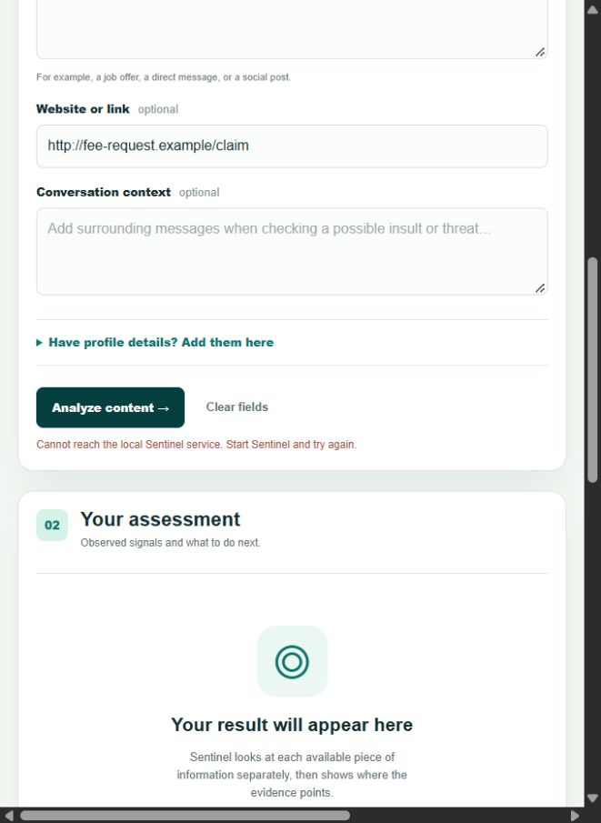

# Sentinel web-app browser check

Checked on 2026-10-05 in the Codex in-app browser at `http://127.0.0.1:8787`. The browser version is not reported by the available tooling. The observed panel width was 661 pixels; this was not a mobile-device emulation. The user chose web-app checks before installing the Chrome extension.

The server used a separate database throughout testing:

```powershell
python -u -m sentinel.server --db data/curation/browser-smoke-20261005.db
```

Only invented messages and `.example` links were submitted. Submitted destinations were not visited. No reputation feed or research model was loaded. The normal `data/cases.db` was not used for the browser tests.

## Observed workflows

| Check | Result and evidence |
| --- | --- |
| Empty submission | Pass: requested a message, URL, conversation or profile details; no assessment or case was created. |
| Combined message and URL | Pass: a synthetic scholarship fee request produced payment/urgency evidence, a review result and an explicit unavailable-reputation explanation. The other assessments remained separate. |
| URL-only submission | Pass: `https://library.example/resources` displayed low observed concern with a statement that this cannot prove safety; harmful content was not assessed and profile evidence was insufficient. |
| Saving is optional | Pass: analysis alone did not add a case; clicking Save created a case and disabled repeated saving. Rechecked after the final fix. |
| Reopen saved case | Pass: Open restored the original input and stored assessment, showed Saved case and disabled Save. |
| Feedback | Pass: Mark incorrect stored feedback on the synthetic case and updated its history row. |
| Clear fields | Pass: removed inputs and the assessment while preserving history. |
| Quoted insult | Pass: surrounding text containing a reported insult displayed quoted/reported-context evidence and requested human review, without establishing cyberbullying or the speaker's intent. |
| Ordinary disagreement | Pass: the same neutral message without the quoted context did not receive a harmful-content warning. |
| Legitimate new-account example | Pass: supplied age of one day, zero followers and ordinary activity still returned insufficient evidence, with no fake-account verdict. |
| Unavailable server | Initially failed; fixed and passed: a new request cleared the previous assessment, hid/disabled Save and displayed a Start Sentinel / try again action. |
| Recovery | Pass: restarting the same test server and retrying the fee request produced the current payment evidence and cleared the error. |
| Narrow-panel history | Initially failed; fixed and passed: a long saved message caused a 1090-pixel content width in a 661-pixel panel. Constraining the case summary reduced content width to 661 pixels. |
| Report API | Pass: both synthetic cases' report responses matched their case IDs, inputs and feedback. |
| Export JSON download | Unverified: the in-app browser did not report a completed download within 15 seconds. No dialog or console error explained it. This does not establish whether Chrome/Brave downloading works; verify a saved JSON file in the real browser. |
| UI Delete | Not tested. The two known synthetic cases were verified and removed through the API; the isolated history was then confirmed empty. This cleanup does not count as a passed UI deletion check. |
| Chrome extension | Deferred at the user's request: toolbar, selected-text and context-menu behavior still need the [extension smoke test](extension-smoke-test.md). |

## Fixes and automated coverage

The original failure was reproduced by analyzing the library URL, stopping the test server, replacing the inputs with a fee request and analyzing again. The UI showed Failed to fetch while retaining the old low-concern assessment and enabled Save button. The client now clears the previous result before requesting analysis and makes input saveable only after that request succeeds.

Clearing the form or opening a saved case invalidates outstanding analysis replies. An old success, error or button cleanup cannot replace a newer view. Saving uses the analyzed input snapshot, locks repeated clicks while pending and prevents late save success/errors from marking a newer assessment as saved. History still refreshes after a successful save that is no longer displayed.

The new tests execute the actual client script with a small DOM boundary and controlled HTTP responses. They cover pending/failed requests, validation errors, late replies after Clear/Open, saving snapshots, save races, duplicate clicks and retry after a failed save. They do not simulate browser rendering, downloads, native input validation or extension behavior.

```powershell
node --test tests/web_client.test.mjs
# 12 tests passed

python -m unittest discover -s tests -q
# 31 tests passed
```

Six initial analysis regression checks and four later saving checks were observed failing before their fixes. A focused code review approved the final saving fix. Browser checks separately confirmed offline recovery, saving/reopening and the layout correction.



## Remaining work

Confirm Export JSON produces a readable saved file and test UI deletion in a real Chrome/Brave test profile. Then complete the extension checklist. Research candidates remain unreviewed and the intake remains empty; the team still needs to admit, independently label and adjudicate real pairs before reporting phishing-model performance.
