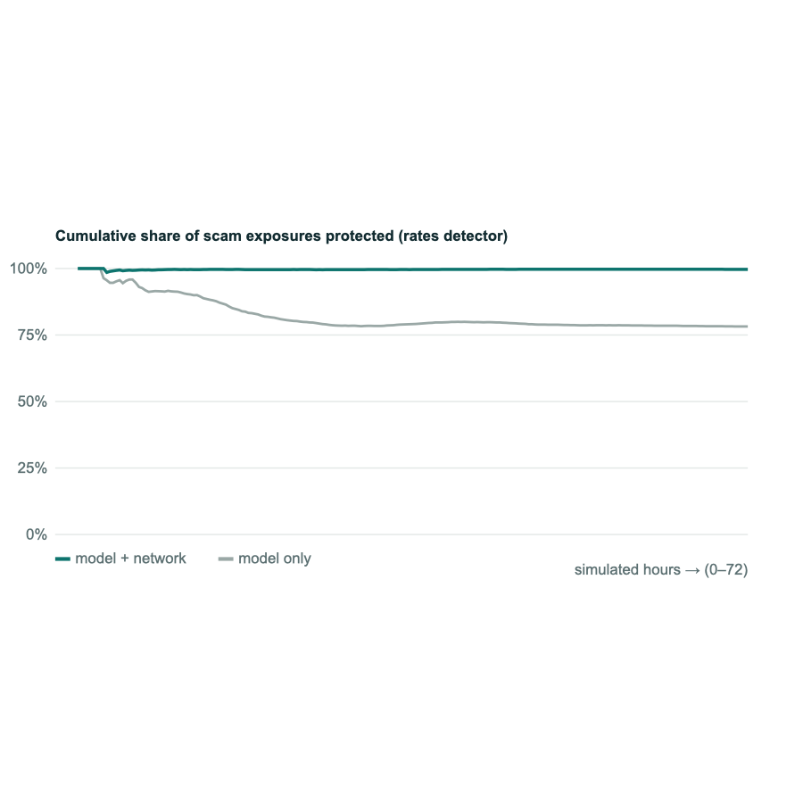

# Community scam network: simulation results (network-v1)

Raw data is in [experiments.json](experiments.json). The design is in [docs/community-network.md](../../../docs/community-network.md). Every number below comes from one seeded sweep: 26 runs of 10,000 simulated users over 72 hours, with about 200 seconds of compute. The real-model runs use **text-ml-v2**, the served model, unless they're marked v1.

## Setup
- **Users:** 10,000. 60% of them opt in to sharing fingerprints. Each refreshes the campaign feed every 30 minutes.
- **Scam campaigns:** 30 in total.
  - 22 are seeded from **held-out test-split** SMS spam and smishing.
  - 8 are seeded from **invented** modern conversational scams written in the style of publicly reported cases: digital arrest, a "new number, send money" message, task jobs, trading groups and similar.
  - Each campaign reaches 200–2,500 users along a logistic curve and **mutates every 6 hours**. Level 0 is the original. Level 1 is reworded, with new numbers and links. Level 2 adds leetspeak. Level 3 mixes leetspeak, look-alike letters and dotted spacing.
- **Genuine bulk messages:** 12 broadcasts drawn from 8 templates (bank debit alert, OTP, salary, telecom, delivery, college, pharmacy, electricity), each reaching 500–3,000 users. Only the 4 large senders (bank alert, OTP, salary, telecom) are on the verified-sender allowlist.
- **Background noise:** 10,000 ordinary messages drawn from test-split ham.
- **User behaviour:** 3% of users who receive a scam their detector missed report it manually. 0.1% report a genuine message by mistake. 5% of genuine-message recipients who see a network warning dispute it.
- **Hub settings:** k = 5, a match needs similarity ≥ 0.4, new clients count at half weight for 24 hours, and each client can make 20 attempts per hour.
- **Two detectors on each device:**
  - **text-ml-v2**, the real served model (v1 in the comparison runs), with its scores computed once per distinct text.
  - **Rates detector**, a controlled stand-in that behaves like the model *on its own test distribution*: 0.4% false positives, and recall falling with mutation from 96% to 85%, 70% and 55%. **These recall values are assumptions, not measurements.**

## 1. The network protects users from scams their own detector misses

| Detector | Model alone | Model + network | Scams caught only by the network | Protection after a campaign is published |
|---|---|---|---|---|
| Rates detector | 78.2% | **99.7%** | 3,901 | 99.8% |
| text-ml-v2 (real) | 86.0% | **93.1%** | 1,280 | 99.9% |
| text-ml-v1 (real) | 85.3% | **91.1%** | 1,049 | 99.9% |

By mutation level (rates detector):

| Level | Model alone | Model + network |
|---|---|---|
| 0 Original | 95.9% | 99.4% |
| 1 Reworded | 85.8% | 99.9% |
| 2 + leetspeak | 69.2% | 99.8% |
| 3 + mixed disguises | 54.5% | 99.2% |

As scammers disguise their messages, each user's own detector gets worse. The network does not, because the fingerprint undoes the disguises and earlier users' reports have already published the campaign. With no mutation, protection reaches 100.0%.

## 2. Modern conversational scams: the real model's blind spot

| Campaign seeds | Model alone | Model + network | Without user reports |
|---|---|---|---|
| Held-out SMS test split (v2) | 96.8% | 99.3% | 96.8% |
| Invented modern scams (v2) | **45.3%** | **69.6%** | 60.6% |
| Invented modern scams (v1) | 41.9% | 65.5% | 56.4% |

The models were trained mostly on 2011–2022 SMS and miss chat-style scams. A digital-arrest message scores 0.05. The network recovers part of the gap, and **manual reports from 3% of users** account for over a third of that gain. Protection stays well below the rates detector's because these campaigns publish later, once enough humans have noticed. Better data for the model is still needed.

## 3. Speed vs privacy: the k-anonymity threshold (rates detector)

| k | Median hours to publish | Median scam exposures before publish | Protection | Genuine messages wrongly warned |
|---|---|---|---|---|
| 3 | 0.95 | 4 | 99.7% | 1.6% |
| 5 | 1.48 | 8 | 99.7% | 2.4% |
| 10 | 2.74 | 16.5 | 99.5% | 3.0% |
| 20 | 3.85 | 34 | 99.1% | 1.2% |

Larger k delays publication and costs a little protection. It doesn't give a clean drop in false warnings, because wrong campaigns are mostly withdrawn by disputes anyway (see section 5).

**How many users share:** at 10% sharing, protection is 98.7% after a median 4.65 hours. At 30% it's 99.4% after 2.48 hours. At 60% it's 99.7% after 1.48 hours. The network works even with low opt-in, just more slowly.

## 4. Privacy check
In every run, an audit searched the full dump of the hub database for 5,054 three-word sequences taken from the simulated messages. **None were found** (privacy check passed in all 24 runs). The hub's columns hold signatures, band keys, hashes, tags, counts and times only.

## 5. False campaigns and poisoning: what defences are needed

Share of genuine bulk messages that got a wrong network warning (rates detector):

| Configuration | Genuine messages wrongly warned | Genuine templates published (ever → at end) |
|---|---|---|
| No defences, no attackers | **54.4%** | 6 → 6 |
| Allowlist + newcomer weight, **no disputes** | 36.7% | 3 → 3 |
| **All defences** (allowlist, newcomer weight, disputes) | **2.4%** | 3 → 0 |
| All defences + every sender verified | 0.0% | 0 → 0 |

**The main finding:** the largest risk isn't attackers. It's **honest false positives at scale.** A genuine message sent to 3,000 people, with 0.4% false positives, already gives about 7 reports, which is more than k = 5. Counting distinct reporters is not enough by itself. It takes the **verified-sender allowlist** together with **recipient disputes** to keep wrong campaigns rare and short-lived.

**Poisoning an unregistered sender** (the pharmacy template, all defences on):

| Attackers | Genuine messages wrongly warned | Target published at end |
|---|---|---|
| 0 | 2.4% | no |
| 5 | 3.3% | no |
| 10 | 3.7% | no |
| 25 | 4.5% | no |
| 50 | 6.0% | no |

Disputes withdraw the poisoned campaign every time, but more attackers keep it alive longer before that happens. Without defences, every genuine template was published whatever the number of attackers, because honest false positives had already done it.

## 6. The network cannot fix a biased detector, so the detector was fixed

| Detector on every device | Genuine bulk messages flagged by the model | Wrongly warned by the network (all defences) | Genuine templates published | Without defences |
|---|---|---|---|---|
| text-ml-v1 | **98.4%** | **54.1%** | 4 (college, delivery, electricity, pharmacy) | 97.9% warned, 8 of 8 templates published |
| **text-ml-v2** | **13.5%** | **0.0%** | none | 13.4% warned, 1 template (bank alert) published |

With v1, the network spread its detector's systematic mistake to everyone. Disputes couldn't overcome about a thousand reports per template. **The network multiplies the quality of its users' detectors.** That's why v1 was retrained into [text-ml-v2](../text-ml-v2/model-card.md), with genuine Indian transactional messages in its training data. v2 also raises scam protection: 91.1% → 93.1% overall, and 65.5% → 69.6% on modern scams. The remaining 13.5% comes mostly from one bank-alert template that v2 still flags. The verified-sender allowlist holds it for review, so the network never publishes it.

## Limits
- **The simulation is a model of the world.** Spread curves, mutation operators, user-report and dispute rates, and the rates detector's recall are assumptions. Change them and the numbers change.
- **The modern scams are invented,** and there are only 8 of them.
- **Not modelled:** scammers disputing their own campaigns using fake accounts (disputes don't yet apply newcomer weight), coordinated groups of fake accounts that persist over time, network delays, and real device diversity.
- **Prototype only:** loopback-only HTTP, SQLite and no authentication beyond optional proof-of-work. It isn't production-ready.
